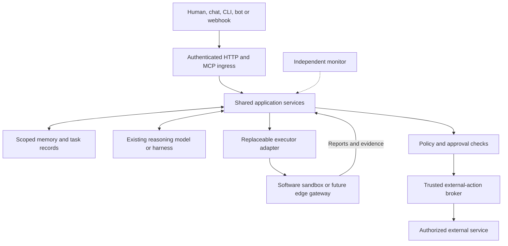

# Shared Agent Platform — Architecture Decision Records v1.1

Date: 2026-11-02 (Asia/Saigon)  
Status: **Final architecture baseline for implementation. Not deployed; runtime qualification and operational gates remain open.**  
Scope: personal-first software agents, shared services for multiple harnesses, and a future extension boundary for IoT and robotics.

## Architecture decision

Build a shared coordination and memory service on Cloudflare by adapting existing products. Keep model providers, harnesses and execution environments replaceable at a small number of application boundaries. Use durable records for work and authority, task-isolated workers for execution, and trusted capabilities for external actions. Keep hardware control and physical safety local to the device domain.

The first deliverable is shared memory accessible to existing clients. An autonomous Router is an additive stage. A chat product, CLI or existing agent platform can supply reasoning before a cloud-hosted Router is enabled.

## How to read this set

“Accepted” means the decision is the implementation baseline requested for this project. It does not mean a product has passed validation or a deployment, subscription, external mutation or hardware action has been authorized. Vendor features are source-reviewed, not benchmarked in this project.

This set consolidates and supersedes the design baseline in `AI_Agent_Platform_ADR_v0.3_Telegram_HITL.md` dated 2026-10-19. It preserves ADR identifiers 001–011, adds ADR-012 and ADR-013, and leaves the historical document unchanged. v1.1 preserves the exact v1.0 archive under provenance. Editorial clarifications are made in place; decision changes require an explicit Amends header/change note or a new ADR. The ADR header is the status source of truth. Future changes must identify the affected record rather than silently rewriting its decision.

| ADR                                                  | Decision                                                                | Status                                                                 | Qualification                                |
| ---------------------------------------------------- | ----------------------------------------------------------------------- | ---------------------------------------------------------------------- | -------------------------------------------- |
| [001](001-platform-scope-and-reuse.md)               | Build a shared platform by adapting existing products                   | Accepted                                                               | Implementation baseline only                 |
| [002](002-existing-harness-and-template-baseline.md) | Reuse an existing harness and qualify templates before adoption         | Accepted principle and initial scaffold; runtime qualification pending | Candidate runtime not qualified              |
| [003](003-model-providers-and-cost-control.md)       | Separate reasoning providers from coordination and budget authority     | Accepted; numerical caps are retained provisional defaults             | Numeric defaults provisional; OD-10          |
| [004](004-executor-contracts-and-portability.md)     | Make executors replaceable at application boundaries                    | Accepted                                                               | Executor tests pending                       |
| [005](005-state-ownership-and-durable-execution.md)  | Keep authoritative work state outside replaceable execution             | Accepted                                                               | State/recovery tests pending                 |
| [006](006-authorization-and-external-effects.md)     | Enforce authority in trusted capabilities and isolate execution         | Accepted; implementation must pass the security gate                   | Gate 4 fixture OPEN; Tier 2 disabled         |
| [007](007-tools-skills-and-configuration.md)         | Use typed tools and version-controlled skills with provenance           | Accepted                                                               | Dependency/tool review pending               |
| [008](008-cloud-edge-and-hardware-extension.md)      | Share mission-level services and keep physical control at the edge      | Accepted boundary; device integration and physical deployment deferred | Separate future hardware gate                |
| [009](009-observability-evaluation-and-recovery.md)  | Measure accepted outcomes and monitor independently                     | Accepted                                                               | No measured SLO or restore drill             |
| [010](010-mvp-scope-and-release-gates.md)            | Ship through measured gates with a small initial scope                  | Accepted; cost defaults require calibration                            | Gate 1 memory-only; OD-09/10                 |
| [011](011-telegram-and-human-approval.md)            | Use Telegram for scoped phone approvals with trusted server-side state  | Accepted owner-directed default; not implemented                       | Not implemented; OD-09 overnight calibration |
| [012](012-shared-memory-and-context-service.md)      | Share scoped application memory across existing harnesses               | Accepted                                                               | Gate 1 Memory; task context Gate 2           |
| [013](013-event-driven-superagent-coordination.md)   | Separate responsive coordination from concurrent task execution         | Accepted architecture; proactive autonomy introduced after validation  | Event Router Gate 5; no runtime evidence     |
| [014](014-identity-and-authorization.md)             | Bind verified principals to explicit workspace authority                | Accepted; owner identity and credential configuration remain open      | OD-01/02/03 configuration OPEN               |
| [015](015-operational-baseline.md)                   | Make operational configuration a prerequisite to retained-data reliance | Accepted; operational values and recovery selection remain open        | OD-04/05/06/07 configuration OPEN            |

Supporting documents: [contracts](contracts.md), [validation and rollout](validation.md), [sources](references.md), [open owner decisions](open-decisions.md), [change classification](baseline-changelog.md), and [static check report](baseline-check-report.md).

## Logical architecture

The diagram shows logical responsibilities. The initial deployment is a small Worker application with Durable Object classes and bindings, not a microservice per box. LLM inference may run with an external provider. CPU-heavy POSIX execution may run elsewhere. No single global LLM session or global writable memory is required.

## Storage and ownership baseline

| Record                                                                 | Authoritative owner                                                                   | Rule                                                                                                      |
| ---------------------------------------------------------------------- | ------------------------------------------------------------------------------------- | --------------------------------------------------------------------------------------------------------- |
| Principal bindings, grants, registration, revocation and stop controls | Operator-controlled authority registry under ADR-014, initially Durable Object SQLite | Read-only to models; current recovery authority must survive rollback                                     |
| Workspace knowledge and memory catalog                                 | Scoped `MemorySpace` repository, initially a Durable Object with SQLite               | Permissions checked before access; derived search indexes are not authority                               |
| Task revision, assignments, approvals, operations and receipts         | Task-specific repository, initially a `TaskRecord` Durable Object with SQLite         | One authoritative writer; authorization-relevant transitions are local transactions                       |
| Shared spend reservations                                              | Account/workspace budget ledger with one authoritative writer                         | Reserve before metered work; reconcile task and provider usage without assuming a cross-store transaction |
| Native transcript and harness inbox                                    | Existing harness/session persistence                                                  | Keep native semantics; reference task IDs instead of duplicating mission state                            |
| Large retained files and logs                                          | R2 when needed                                                                        | SQL stores references, digest and generation; sandbox files are temporary                                 |
| Multi-step execution checkpoints                                       | Existing harness lifecycle, or Workflows for the chosen pipeline                      | Exactly one scheduler owns a given retry/timer; no implicit dual retry loops                              |
| Search, reporting and cross-task projections                           | Optional FTS, Vectorize or D1 projection                                              | Rebuildable; must not override task or permission records                                                 |

These are logical ownership boundaries. Use existing harness storage where it already provides the required guarantee. Introduce separate objects as each responsibility is implemented; no global workspace lock or distributed transaction across all stores is assumed.

## Carry-forward defaults

The following are retained engineering defaults from v0.3, not new spending or access permissions:

| Area                                  | Baseline                                                                                                                                     |
| ------------------------------------- | -------------------------------------------------------------------------------------------------------------------------------------------- |
| Initial workloads                     | Public technical research, ADR/design review, read-only permitted repository triage, isolated code/test proposals and status digests         |
| Data                                  | Employer/client confidential data, production secrets and sensitive personal/third-party records remain excluded until separately authorized |
| Local hardware                        | No always-on MacBook or local runner assumed                                                                                                 |
| Notifications and approval            | Owner-paired Telegram private DM; authenticated web inbox as fallback                                                                        |
| Approval expiry                       | Existing 15-minute default, enforced at decision and first dispatch; OPEN OD-09 for overnight phone review                                   |
| Provisional infrastructure ceiling    | USD 15/month                                                                                                                                 |
| Provisional metered model ceiling     | USD 20/month; USD 3/day                                                                                                                      |
| Provisional estimated task thresholds | USD 0.50 warning; USD 1.00 stop before additional work                                                                                       |
| Physical/production privilege         | Disabled in MVP, including actuation, production deployment, secret rotation and privileged infrastructure changes                           |

The USD 35 combined monthly figure is an operating target, not a mathematical billing cap. Infrastructure and inference need separate enforcement and reconciliation. Existing subscription access does not automatically provide API credit or permission for unattended use.

## Explicit scope limits

Initial work does not include a new agent kernel, a universal provider abstraction, a marketplace of dynamic plugins, a custom semantic-memory engine, a new robotics stack, CRDT synchronization, active-active multi-cloud coordination or unrestricted public-chat autonomy. Protocol and product additions require an observed use case and the relevant gate in VALIDATION.md.

## Changes from v0.3

- Reuse and integration effort are the primary product-selection criteria.
- Shared memory through authenticated application contracts is the first release.
- Think durable submissions are the default coordinator scaffold; Pi remains a qualified alternative rather than a predetermined winner.
- State ownership follows task/session consistency needs and trust boundaries, rather than a mandatory workspace-wide singleton.
- Task revision and execution generation fence late results, approvals and effects.
- The Super-agent Router/Worker split, deterministic follow-up routing and bounded background work become explicit architecture decisions.
- IoT and robotics share mission-level contracts; real-time loops and safety stay at the edge.
- “Twin-flame” is unresolved terminology. Digital-twin integration is considered only conditionally and is not a selected product or MVP dependency.

## Completion evidence

This is the v1.1 implementation baseline, with owner decisions and runtime gates still open. Required future evidence includes: cross-client scoped recall; replacement after an executor failure; rejection of stale revisions and generations; reconciled external effects; approval replay resistance; and bounded cost and recovery behavior. See VALIDATION.md for the evidence matrix.

## v1.1 change and verification rules

New decisions are [ADR-014](014-identity-and-authorization.md) and [ADR-015](015-operational-baseline.md). Existing decision changes have Amends/change-note headers; all editorial/substantive scopes are recorded in CHANGELOG.md. Gate 1 is separable from Tasks/Assignments (Gate 2), replaceable external execution (Gate 3), Approval/Operation (Gate 4) and Router Events (Gate 5). Nothing is deployed, Tier 2 remains disabled, and no always-on local runner or new product is introduced.

The original distribution audit and input digests are documented in [source provenance](source-provenance.md). Repository copies have editorial link and formatting changes. Runtime evidence remains governed by [validation](validation.md).

## Repository documentation — 2026-11-03

The 15 numbered records retain their original IDs, status headers, decision text, and amendment history. Read [project decisions](project-decisions.md) for subsequently confirmed owner choices and [Cloudflare reference guide](cloudflare-reference-guide.md) for the verified technical reading order. The [implementation specification](https://github.com/caocuong2404/agents/issues/1) uses this baseline. See [source provenance](source-provenance.md) for import and verification boundaries.
